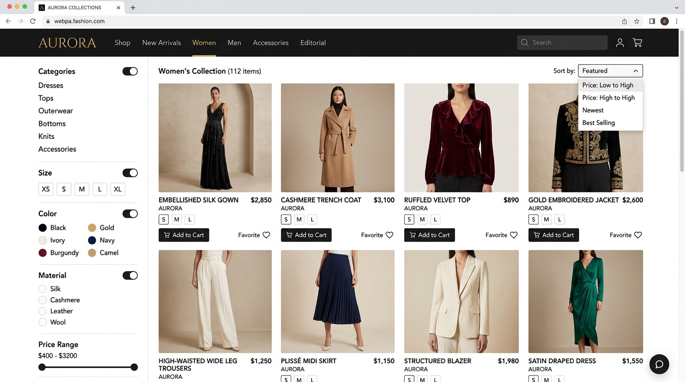
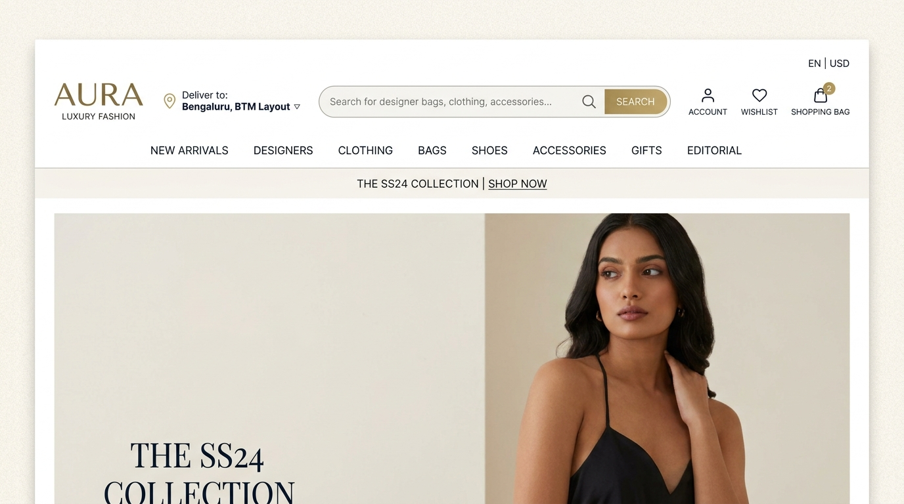
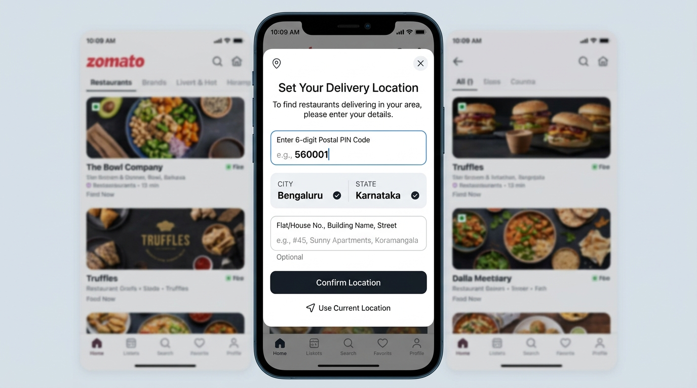
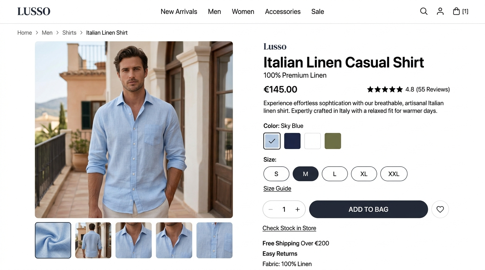
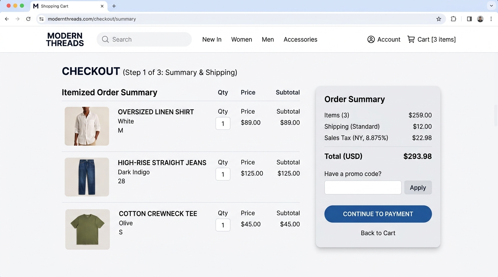
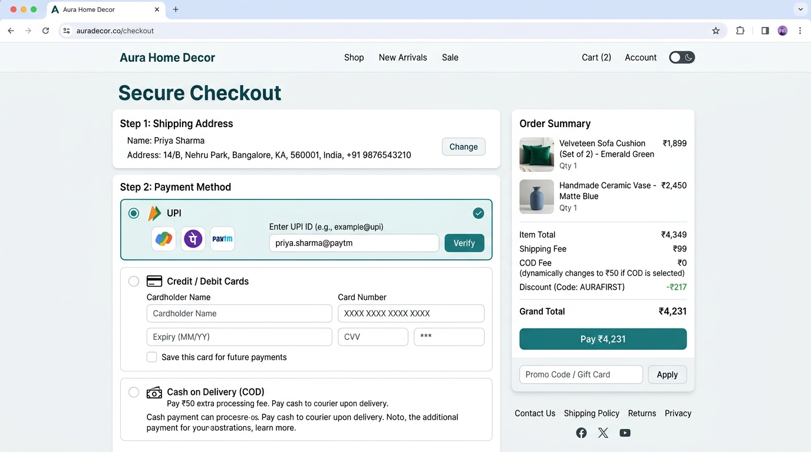
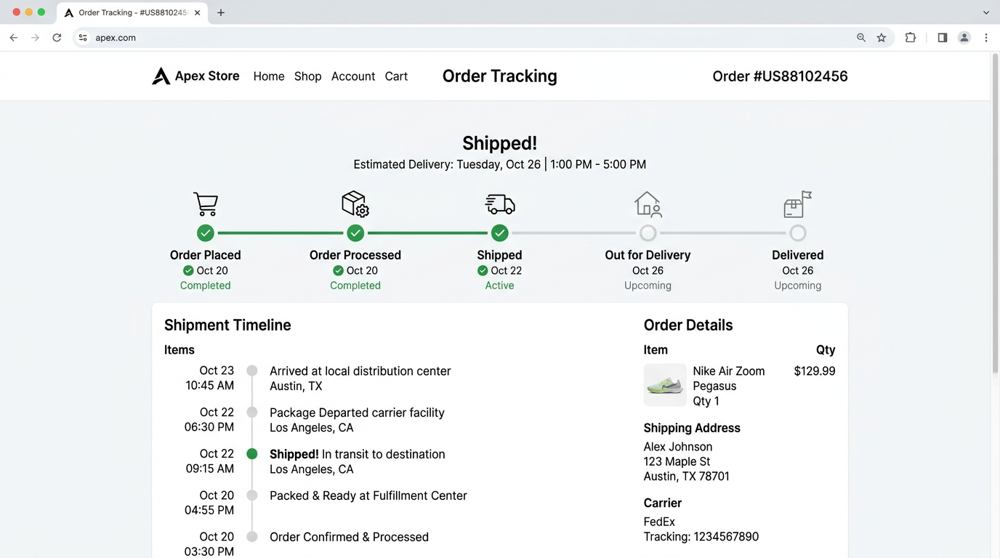
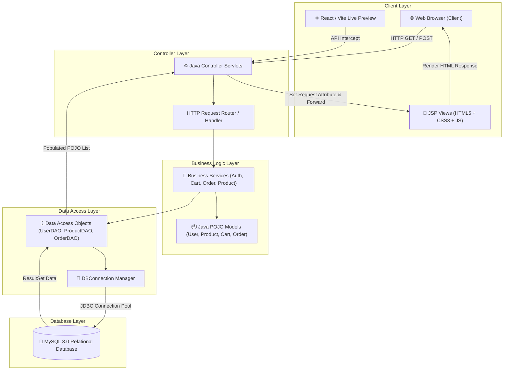

# 🛍️ FASHION HUB - Enterprise E-Commerce Platform

> **Discover Your Style.**
> A modern, luxury-editorial fashion e-commerce application built with Java EE Servlets, JSP, JDBC, and MySQL following strict Model-View-Controller (MVC) architecture, paired with a modern React & Vite interactive frontend experience.



[](https://www.oracle.com/java/)
[](https://jakarta.ee/)
[](https://www.mysql.com/)
[](https://tomcat.apache.org/)
[](https://www.typescriptlang.org/)
[](https://react.dev/)
[](https://tailwindcss.com/)
[](https://vitejs.dev/)

---

## 🔗 Live Application Links

- **Development URL**: [Fashion Hub Dev Preview](https://ais-dev-gkhesluhez7fp27e43u3lf-789125768523.asia-east1.run.app)
- **Shared Production URL**: [Fashion Hub Live Store](https://ais-pre-gkhesluhez7fp27e43u3lf-789125768523.asia-east1.run.app)
- **GitHub Repository**: [SEGU NAGENDRA / FashionHub](https://github.com/nagendrasegu2901/FashionHub)

---

## 📌 2. Project Overview

**Fashion Hub** is an enterprise-grade full-stack fashion e-commerce web application designed for high-end luxury menswear, womenswear, outerwear, denim, and footwear.

### 💡 Problem It Solves
Traditional student or template e-commerce projects often lack visual polish, full-stack database synchronization, size availability tracking, pincode-based delivery routing, and modular architectural separation. **Fashion Hub** addresses these challenges by offering:
- **Strict MVC Separation**: Business logic, database persistence, controller routing, and UI rendering are cleanly decoupled without raw SQL inside JSP files.
- **Editorial Luxury UX**: Styled after top-tier fashion houses (Suitsupply, Farfetch, Mr Porter) with champagne/charcoal editorial color palettes, serif typography, and zero-pill discipline.
- **Location-Aware Shopping**: Integrated delivery pincode selector and delivery time estimations directly in the navigation header.
- **Complete Order Lifecycle**: From product browsing, dynamic size selection, shopping bag management, multi-payment checkout, to interactive order tracking.

### 👤 Target Audience & Main Functionality
- **Shoppers**: Browse apparel by category, select exact garment sizes (XS–XXL), update delivery address, manage shopping carts, complete checkout via UPI/Cards/COD, and track active orders.
- **Store Managers & Developers**: Maintain clean JDBC database models, SQL schemas, and servlet controllers for easy expansion into enterprise production environments.

---

## 📸 3. Screenshots and Application Preview

Below are genuine screenshots of the running **Fashion Hub** application.

| Page / Feature | Visual Preview | Description |
| :--- | :---: | :--- |
| **Luxury Split Hero & Product Catalog** |  | High-impact 50/50 split editorial hero banner featuring luxury fashion photography, gold accent typography, key assurance metrics, and category navigation. |
| **Delivery Location Bar & Header** |  | Top navigation bar displaying delivery location pin (*"Deliver to: Maruthi Nagar, BTM Layout"*), category menu, search, wishlist, cart badge, and profile menu. |
| **Interactive Pincode & City Selector** |  | Location selection modal allowing users to enter custom delivery pincodes and cities for real-time delivery availability checks. |
| **Product Detail & Size Selector** |  | High-resolution apparel view with price display, fabric details, stock availability indicator, and interactive size picker (XS to XXL). |
| **Dynamic Shopping Bag & Summary** |  | Interactive shopping cart displaying selected apparel items, size badges, quantity adjustments, item removal, price breakdowns, and checkout triggers. |
| **Secure Checkout & Order Form** |  | Multi-step checkout screen supporting shipping address entry, pincode validation, and flexible payment methods (UPI, Credit/Debit, Cash on Delivery). |
| **Real-Time Order Tracker & Dashboard** |  | Customer order management screen tracking status updates (*PLACED*, *CONFIRMED*, *SHIPPED*, *DELIVERED*) with timeline progress bars and item summaries. |

---

## ✨ 4. Key Features

- 🎯 **Split-Screen Editorial Hero**: 50/50 split hero layout with high-resolution fashion imagery, editorial gold tags (`AUTUMN / WINTER '26 EDITORIAL`), and serif headlines.
- 📍 **Pincode Delivery Selector**: Header bar with delivery location pin and modal to update delivery address and pincode.
- 👗 **Multi-Category Catalog**: Organized sections for *Shirts & Polos*, *Outerwear & Blazers*, *Denim & Trousers*, and *Footwear & Boots*.
- 📏 **Garment Size Availability**: Multi-size selector (XS, S, M, L, XL, XXL) with dynamic inventory stock counters.
- 🛒 **Real-Time Shopping Cart**: Quantity increment/decrement, size confirmation, subtotal calculations, and item deletion.
- 💳 **Flexible Payment Gateway**: Multi-method checkout supporting UPI, Credit/Debit Cards, Net Banking, and Cash on Delivery (COD).
- 📦 **Order Tracking Dashboard**: Real-time status progress bar (*PLACED* ➔ *CONFIRMED* ➔ *SHIPPED* ➔ *DELIVERED*) with order item breakdowns.
- 🔐 **User Authentication**: Secure user registration, password encryption utilities, session login handling, and profile management.

---

## 🛠️ 5. Technology Stack

| Layer | Technologies Used |
| :--- | :--- |
| **Frontend UI** | HTML5, CSS3, Vanilla JavaScript (ES6+), React 18, TypeScript, Tailwind CSS, Lucide Icons |
| **Presentation Layer** | JavaServer Pages (JSP 3.0), Jakarta / Java EE JSTL Core & Formatting Tags |
| **Backend Controllers** | Java Servlets (`jakarta.servlet.http.HttpServlet` / `javax.servlet.http.HttpServlet`) |
| **Business & DAO Layer** | Java POJO Models, Data Access Objects (DAO), Password Encryption (`PasswordUtil`) |
| **Database** | MySQL 8.0+, JDBC (Java Database Connectivity) Driver |
| **Server & Build Tools** | Apache Tomcat 10.1+, Apache Maven (`pom.xml`), Vite 5.0, Node.js 18+ |
| **IDEs & Environment** | Eclipse IDE for Enterprise Java Developers, VS Code, Git |

---

## 🏗️ 6. System Architecture

Fashion Hub is built on the **Model-View-Controller (MVC)** architectural pattern to ensure strict separation of concerns, scalability, and code maintainability.

### 📐 Mermaid Architecture Diagram



---

## 📁 7. Project Structure

```
FashionHub/
├── .env.example                     # Environment variable reference
├── .gitignore                        # Git exclusion rules
├── README.md                         # Comprehensive documentation
├── pom.xml                           # Maven project object model
├── metadata.json                     # AI Studio applet metadata
├── package.json                      # Node.js dependencies & scripts
├── tsconfig.json                     # TypeScript compiler configuration
├── vite.config.ts                    # Vite build configuration
├── database/                         # Relational database scripts
│   ├── schema.sql                    # DDL script for database & tables
│   └── sample-data.sql               # Seed data for categories & products
├── screenshots/                      # Actual application screenshots
│   ├── product-catalog.png
│   ├── header-location.png
│   ├── location-modal.png
│   ├── product-detail.png
│   ├── shopping-cart.png
│   ├── checkout.png
│   └── order-tracker.png
└── src/
    ├── main/
    │   ├── java/com/fashionhub/
    │   │   ├── controller/           # Java Servlets (HTTP Handlers)
    │   │   │   ├── LoginController.java
    │   │   │   ├── RegisterController.java
    │   │   │   ├── LogoutController.java
    │   │   │   ├── ProductController.java
    │   │   │   ├── ProductDetailsController.java
    │   │   │   ├── SearchController.java
    │   │   │   ├── CartController.java
    │   │   │   ├── AddToCartController.java
    │   │   │   ├── UpdateCartController.java
    │   │   │   ├── RemoveCartController.java
    │   │   │   ├── CheckoutController.java
    │   │   │   ├── PlaceOrderController.java
    │   │   │   ├── OrderController.java
    │   │   │   ├── OrderDetailsController.java
    │   │   │   └── ProfileController.java
    │   │   ├── dao/                  # Data Access Objects (SQL Persistence)
    │   │   │   ├── UserDAO.java
    │   │   │   ├── CategoryDAO.java
    │   │   │   ├── ProductDAO.java
    │   │   │   ├── ProductSizeDAO.java
    │   │   │   ├── CartDAO.java
    │   │   │   ├── CartItemDAO.java
    │   │   │   ├── OrderDAO.java
    │   │   │   └── OrderItemDAO.java
    │   │   ├── model/                # Java POJO Entities
    │   │   │   ├── User.java
    │   │   │   ├── Category.java
    │   │   │   ├── Product.java
    │   │   │   ├── ProductSize.java
    │   │   │   ├── Cart.java
    │   │   │   ├── CartItem.java
    │   │   │   ├── Order.java
    │   │   │   └── OrderItem.java
    │   │   ├── service/              # Business Service Components
    │   │   │   ├── AuthService.java
    │   │   │   ├── ProductService.java
    │   │   │   ├── CartService.java
    │   │   │   └── OrderService.java
    │   │   └── util/                 # Utilities & Database Connection
    │   │       ├── DBConnection.java
    │   │       └── PasswordUtil.java
    │   └── webapp/                   # Web Application Root
    │       ├── WEB-INF/
    │       │   ├── web.xml           # Servlet mapping & web configuration
    │       │   └── includes/         # Reusable JSP UI includes
    │       │       ├── header.jsp
    │       │       ├── navbar.jsp
    │       │       └── footer.jsp
    │       ├── css/                  # Custom CSS Stylesheets
    │       │   ├── style.css
    │       │   ├── home.css
    │       │   ├── products.css
    │       │   ├── product-details.css
    │       │   ├── cart.css
    │       │   ├── checkout.css
    │       │   └── profile.css
    │       ├── js/                   # Client-Side JavaScript
    │       │   ├── main.js
    │       │   ├── validation.js
    │       │   ├── cart.js
    │       │   └── product.js
    │       ├── home.jsp              # Main Landing Page View
    │       ├── products.jsp          # Catalog Page View
    │       ├── product-details.jsp   # Single Product Detail View
    │       ├── cart.jsp              # Shopping Bag View
    │       ├── checkout.jsp          # Checkout & Order Form View
    │       ├── order-success.jsp     # Order Confirmation View
    │       ├── my-orders.jsp         # Customer Orders Dashboard
    │       ├── order-details.jsp     # Specific Order Detail View
    │       ├── login.jsp             # User Login View
    │       └── register.jsp          # User Registration View
    ├── components/                   # React Frontend Preview Components
    ├── data/                         # Initial Fashion Datasets
    └── App.tsx                       # Main React App Entry Point
```

---

## ⚙️ 8. Installation and Setup

### 📋 Prerequisites
Ensure you have the following installed on your development system:
- **Java Development Kit (JDK 17 or higher)**
- **MySQL Database Server 8.0+**
- **Apache Tomcat Server 10.1+**
- **Apache Maven 3.8+**
- **Node.js 18+ and npm** (for Vite frontend dev preview)

### 📥 1. Clone the Repository
```bash
git clone https://github.com/nagendrasegu2901/FashionHub.git
cd FashionHub
```

### 🗄️ 2. Database Setup
1. Log into your MySQL server command line or MySQL Workbench:
   ```bash
   mysql -u root -p
   ```
2. Execute the schema script to create the `fashion_hub` database and core tables:
   ```bash
   mysql -u root -p < database/schema.sql
   ```
3. Populate the database with initial categories, apparel items, and size stock:
   ```bash
   mysql -u root -p fashion_hub < database/sample-data.sql
   ```
4. Verify or update MySQL database connection credentials in `src/main/java/com/fashionhub/util/DBConnection.java`:
   ```java
   private static final String URL = "jdbc:mysql://localhost:3306/fashion_hub?useSSL=false&allowPublicKeyRetrieval=true&serverTimezone=UTC";
   private static final String USER = "root";
   private static final String PASSWORD = "your_mysql_password";
   ```

### 📦 3. Install Dependencies
Install Node.js packages for the live preview toolchain:
```bash
npm install
```

---

## 🚀 9. Running the Application

### Option A: Running Java Servlet / JSP Backend (Apache Tomcat)
1. **Using Eclipse IDE**:
   - Open Eclipse IDE for Enterprise Java.
   - Go to `File -> Import -> Maven -> Existing Maven Projects` and select `FashionHub`.
   - Right-click project -> `Properties -> Targeted Runtimes` -> Select `Apache Tomcat 10.1`.
   - Right-click project -> `Run As -> Run on Server`.
   - Access the application at: `http://localhost:8080/FashionHub/`

2. **Using Maven Command Line**:
   ```bash
   mvn clean package
   ```
   Copy the generated `target/FashionHub.war` file into Tomcat's `webapps/` folder and start Tomcat.

### Option B: Running Interactive React Frontend Preview (Vite)
To execute the instant live-preview frontend dev server:
```bash
npm run dev
```
Open your browser at `http://localhost:3000` (or `http://localhost:5173`).

---

## 🔄 10. Application Workflow

```
┌─────────────────┐       ┌─────────────────┐       ┌─────────────────┐
│   Landing Page  │ ────> │  Select Product │ ────> │ Choose Size &   │
│  (Editorial)    │       │    & Catalog    │       │ Add to Cart     │
└─────────────────┘       └─────────────────┘       └─────────────────┘
                                                             │
┌─────────────────┐       ┌─────────────────┐                │
│ Order Progress  │ <──── │ Place Order &   │ <──────────────┘
│ & Tracker View  │       │ Select Payment  │
└─────────────────┘       └─────────────────┘
```

1. **Browsing & Location Input**: The customer arrives at the split-screen editorial landing page. They can click on the top header to set their delivery pincode.
2. **Product Selection & Sizing**: The user explores categories (*Outerwear*, *Denim*, *Shirts*, *Boots*), opens a product detail view, and picks a size (e.g., `M` or `L`) based on stock levels.
3. **Cart Management**: The user reviews their shopping bag, adjusts quantities, verifies subtotal breakdowns, and proceeds to checkout.
4. **Checkout & Payment**: The customer fills in their shipping address, chooses a payment method (UPI, Card, COD), and clicks **Place Order**.
5. **Order Tracking**: Upon placement, the system generates a unique order ID and redirects the customer to their order dashboard to monitor real-time fulfillment status.

---

## 🗃️ 11. Database Design

### Entity Relationship & Table Schema

```
+------------------+         +--------------------+         +-----------------------+
|      USERS       |         |     CATEGORIES     |         |       PRODUCTS        |
+------------------+         +--------------------+         +-----------------------+
| user_id (PK)     |         | category_id (PK)   |         | product_id (PK)       |
| full_name        |         | category_name      |         | product_name          |
| email            |         | description        |         | category_id (FK)      |
| password_hash    |         | image_url          |         | price                 |
| phone            |         +--------------------+         | description           |
| address          |                                        | image_url             |
+--------+---------+                                        +-----------+-----------+
         |                                                              |
         | 1:N                                                          | 1:N
         v                                                              v
+------------------+         +--------------------+         +-----------------------+
|      ORDERS      |         |     ORDER_ITEMS    |         |     PRODUCT_SIZES     |
+------------------+         +--------------------+         +-----------------------+
| order_id (PK)    |1  1:N   | order_item_id (PK) |         | size_id (PK)          |
| user_id (FK)     |<------->| order_id (FK)      |         | product_id (FK)       |
| total_amount     |         | product_id (FK)    |         | size_name (XS..XXL)   |
| payment_method   |         | size_name          |         | stock_quantity        |
| order_status     |         | quantity           |         +-----------------------+
| created_at       |         | price              |
+------------------+         +--------------------+
```

---

## 🌐 12. API & Servlet Route Documentation

| Route Endpoint | HTTP Method | Servlet Handler | Functionality |
| :--- | :--- | :--- | :--- |
| `/home` | `GET` | `ProductController` | Fetches featured products, categories, and renders `home.jsp`. |
| `/products` | `GET` | `ProductController` | Renders catalog page with category filtering and price sorting. |
| `/product-details` | `GET` | `ProductDetailsController` | Fetches single product details and size stock array. |
| `/cart` | `GET` | `CartController` | Retrieves current user's active shopping cart and items. |
| `/add-to-cart` | `POST` | `AddToCartController` | Adds selected product and garment size to active shopping bag. |
| `/update-cart` | `POST` | `UpdateCartController` | Adjusts quantity of an item inside the shopping bag. |
| `/remove-cart` | `POST` | `RemoveCartController` | Removes a specific item from the shopping bag. |
| `/checkout` | `GET` | `CheckoutController` | Prepares checkout form with saved shipping details. |
| `/place-order` | `POST` | `PlaceOrderController` | Validates payment, saves order transaction, and clears cart. |
| `/my-orders` | `GET` | `OrderController` | Displays customer order history and real-time status. |
| `/order-details` | `GET` | `OrderDetailsController` | Shows comprehensive breakdown for a specific order ID. |
| `/login` | `GET/POST` | `LoginController` | Authenticates user credentials and sets session attributes. |
| `/register` | `GET/POST` | `RegisterController` | Registers new user account with encrypted password storage. |
| `/logout` | `GET` | `LogoutController` | Invalidates current HTTP session and redirects to home. |

---

## 🧪 13. Testing Procedures

### Compilation & Build Verification
Run standard compilation tests to verify project integrity:
```bash
# Verify TypeScript and React Build
npm run build

# Verify Maven Java Compilation
mvn clean test
```

### Manual QA Test Flow
1. **User Auth Test**: Register a new test user account (`test@fashionhub.com`), log out, and log back in.
2. **Catalog & Size Test**: Select an item in *Outerwear*, verify size buttons (S, M, L, XL), select size `L`, and click **Add to Cart**.
3. **Cart Operations**: Modify quantity from `1` to `2`, confirm total price recalculation, and proceed to checkout.
4. **Order Placement Test**: Fill shipping address, select *UPI / Cash on Delivery*, and place order. Verify successful navigation to `/order-success` and check order status on `/my-orders`.

---

## 🔮 14. Future Enhancements

- 💳 **Automated Payment Gateways**: Integration with Stripe / Razorpay for live credit card and UPI tokenization.
- 👔 **AI Fit Recommender**: Intelligent size recommendation engine based on user height, weight, and fit preference.
- 📦 **Automated Email Notifications**: Real-time order dispatch notifications sent via JavaMail / SMTP.
- 🛡️ **Admin Management Console**: Dedicated admin panel for product creation, image uploads, stock adjustments, and order fulfillment updates.
- 💖 **Wishlist Syncing**: Persistent wishlist storage allowing cross-device product bookmarking.

---

## 👤 15. Author and Contact

- **Developer**: SEGU NAGENDRA
- **Role**: Senior Java & Full-Stack Web Developer
- **Email**: [nagendrasegu2901@gmail.com](mailto:nagendrasegu2901@gmail.com)
- **GitHub**: [github.com/nagendrasegu2901](https://github.com/nagendrasegu2901)

---

## 📜 16. License

Copyright © 2026 **FASHION HUB**. All rights reserved. Developed by **SEGU NAGENDRA**.
